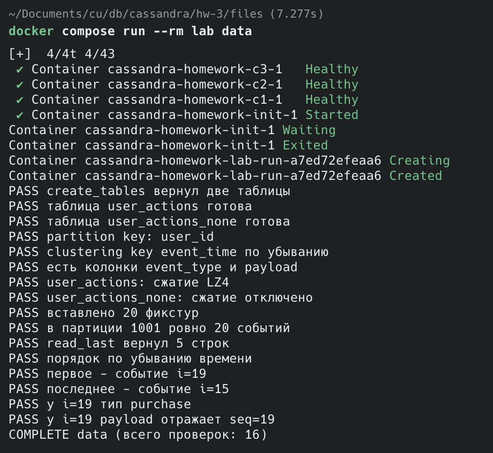
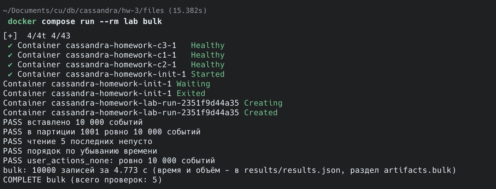
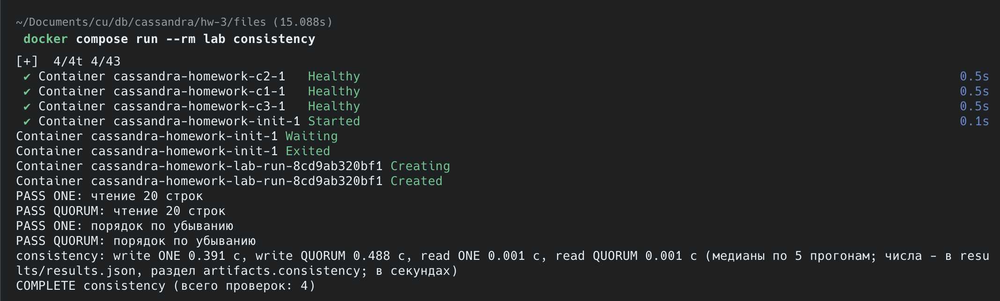
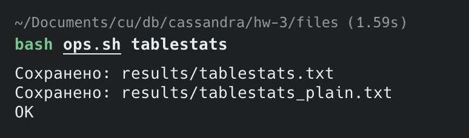
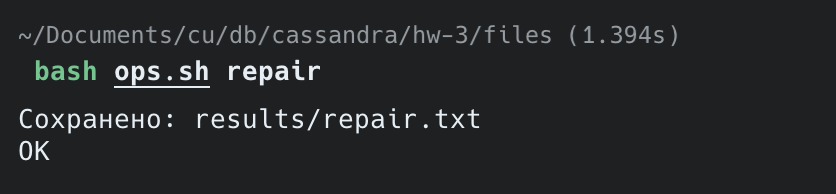
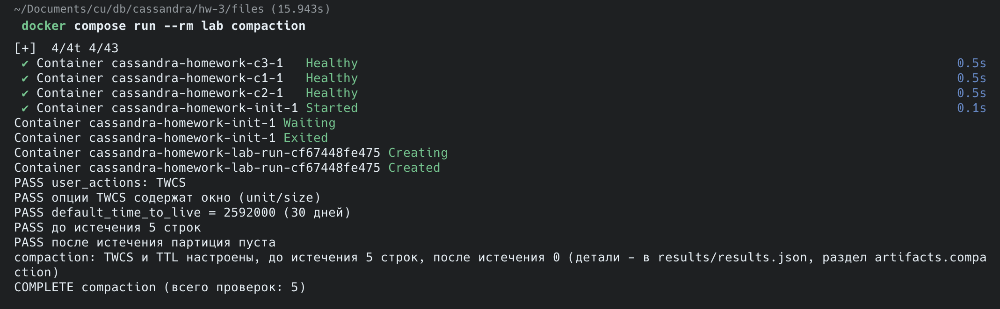
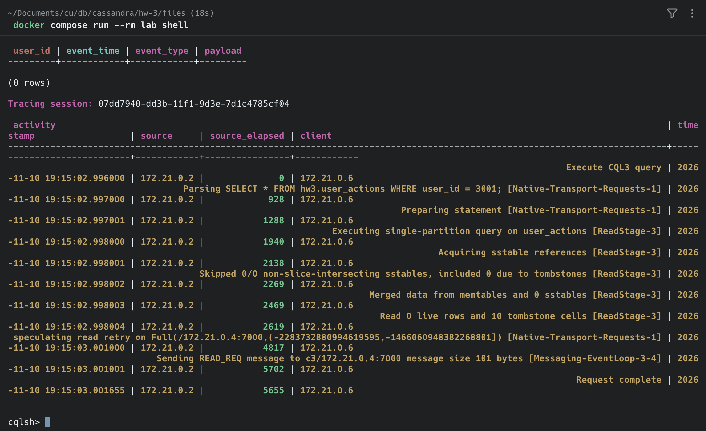
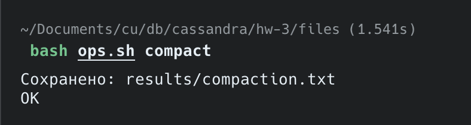
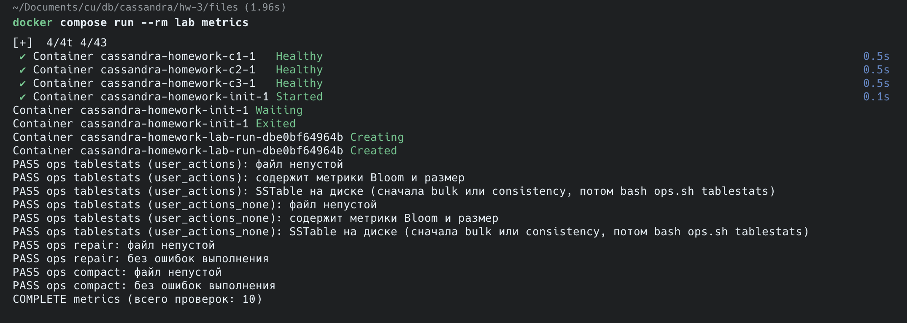
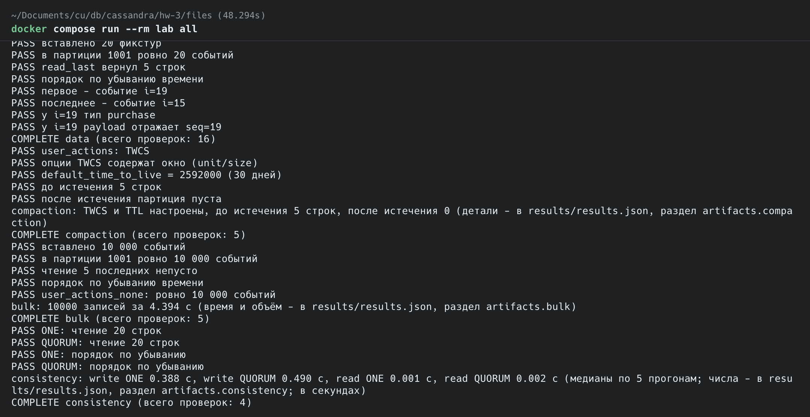

# ДЗ 3 - Cassandra

Решение - files/solution.py, результаты прогонов - files/results/, скриншоты - img/.

## Как воспроизвести

Все команды выполняются из папки files/:

    docker compose up -d
    docker compose run --rm lab reset
    docker compose run --rm lab data
    docker compose run --rm lab bulk
    bash ops.sh tablestats
    docker compose run --rm lab consistency
    bash ops.sh repair
    docker compose run --rm lab compaction
    bash ops.sh compact
    docker compose run --rm lab metrics
    docker compose run --rm lab all
    docker compose down

Числа в таблицах ниже - из итогового прогона *all* (files/results/results.json) и файлов ручных шагов, поэтому на скриншотах отдельных сценариев они могут немного отличаться.

## 2. Таблица и модель данных

### Почему партиция по user_id и зачем обратный порядок кластеризации?

Партиционирование по user_id позволяет хранить все события одного юзера в одной партиции. Т.е. запрос за событиями конкретного юзера будет направлен координатором только на те ноды (ноду), где есть эта партиция.

Обратный порядок кластеризации позволяет хранить события в обратном хронологическом порядке - это покрывает основной запрос - последние события юзера X.

### Что произойдёт при двух событиях одного пользователя с одинаковым event_time, почему для аудита это риск и как изменить схему, чтобы события не затирались.

Одно из событий будет затирать другое - у них полностью одинаковый primary key. Это риск, потому что никакой ошибки не произойдет, Cassandra молча перезапишет первое событие вторым, фактически аудит будет невалидным. Чтобы этого не случилось - можно на стороне клиента событиям присваивать уникальный идентификатор, а эту колонку добавить в clustering key после event_time.

## 3. Вставка и чтение

### Результат *bulk*

| Что вставлено | Сколько | Время |
|---|---|---|
| События пользователя 1001 (*login*, *purchase*, *view*) | 10 000 | 4,394 с (≈ 0,44 мс на запись) |

### Что даёт PreparedStatement

1. Запрос кешируется на стороне узла Cassandra. При *prepare* Cassandra один раз парсит и валидирует запрос и возвращает его id; если такой запрос уже был подготовлен, сразу возвращается его id. Дальше при выполнении по сети передаются только id и значения параметров, повторного парсинга нет.
2. Вместе с id драйверу возвращаются метаданные: какой параметр является ключом партиционирования. Драйвер сам считает токен и сразу отправляет запрос на одну из реплик партиции (token-aware routing), без лишнего перехода через узел-координатор, на котором может не быть данных. В нашем стенде N = RF = 3, все узлы - реплики, поэтому здесь выигрыша нет.
3. Значения передаются отдельно от текста запроса и не интерпретируются как CQL, поэтому CQL-инъекция невозможна. Заодно драйвер проверяет типы параметров.

## 4. Консистентность

### Замеры *consistency*

Медианы из 5 прогонов. Запись - 1000 вставок, чтение - 20 последних событий.

| Уровень | Запись, мс | Чтение, мс |
|---|---|---|
| ONE | 388 | 1 |
| QUORUM | 490 | 2 |

QUORUM медленнее, т.к. координатор ждёт ответа от двух реплик, а не от одной.

### Формула W + R > N

N - replication factor (у нас 3), W - сколько реплик должны подтвердить запись, R - сколько реплик должны ответить на чтение. Если W + R > N, то множество реплик, на которые записали, пересекается с множеством реплик, с которых читают - т.е. хотя бы одна из них вернёт актуальные данные. Координатор сравнивает ответы и отдаёт версию с самым свежим timestamp, а отставшие реплики чинятся через read repair.

Между ONE и QUORUM разница в том, сколько реплик нужно дождаться: ONE - одну, QUORUM - большинство (2 из 3). Для записи это сколько реплик подтвердят запись, для чтения - со скольких реплик прочитают и сверят данные.

QUORUM + QUORUM = 4 > 3, поэтому чтение всегда видит последнюю подтверждённую запись, и при этом кластер переживает падение одного узла. ONE + ONE = 2 - такой гарантии нет.

### Какой уровень выбрать для ленты событий

Кворум на запись, ONE на чтение. Лента не требует строгой консистентности при чтении - если свежего события ещё нет, оно появится при следующем запросе ленты. Кворум на запись нужен для отказоустойчивости: событие подтверждено, только когда оно есть на двух репликах, и не потеряется при падении одного узла.

W + R = 3, что не больше N, т.е. гарантии прочитать только что записанное нет - для ленты это допустимо. Если понадобится строгое чтение, можно читать с QUORUM, т.к. уровень задаётся на каждом запросе.

## 5. Сжатие

| Таблица | Space used (total) | SSTable count | SSTable Compression Ratio |
|---|---|---|---|
| user_actions (LZ4) | 150 221 байт (~147 КБ) | 1 | 0.38 |
| user_actions_none (без сжатия) | 385 147 байт (~376 КБ) | 1 | -1 (сжатия нет) |

С LZ4 таблица занимает примерно в 2,6 раза меньше места. Статистика снята после *bulk* (files/results/tablestats.txt, files/results/tablestats_plain.txt).

### Компромисс сжатия

При записи компромисс небольшой - сам INSERT не сжимается, данные сжимаются блоками при flush memtable в SSTable и заново при компакциях. Т.е. платим CPU только в фоне. При чтении компромисс тоже небольшой - распаковывается только тот блок, в котором лежит нужная строка. В целом при чтении узким местом является диск, а не процессор - поэтому зачастую дешевле прочитать с диска меньше данных и распаковать их, чем читать несжатые данные целиком.

Для нашего кейса сжатие выгодно, т.к. в событиях много повторов (одни и те же event_type, однотипный JSON в payload) - они хорошо жмутся, а журнал аудита в основном пишется и занимает много места.

## 6. Bloom-фильтр

| Показатель | Значение |
|---|---|
| Bloom filter false positives | 0 |
| Bloom filter false ratio | 0.00000 |

### Что делает bloom-фильтр

Bloom-фильтр - это вероятностная структура данных, в Cassandra он строится для каждой SSTable по partition key и хранится в памяти. При записи ключ прогоняется через несколько хэш-функций, каждая из которых даёт номер бита, в который ставится единица. При чтении ключ хэшируется так же и проверяются полученные биты. Если хотя бы в одном из них 0 - партиции в этой SSTable точно нет, и на диск идти не нужно. Если во всех единицы - данные скорее всего есть, и тогда Cassandra читает SSTable с диска. Хэширование и проверка битов в памяти выполняются быстро, поэтому так экономятся лишние чтения с диска.

Bloom-фильтр может дать false positive, но никогда не даёт false negative - в худшем случае Cassandra прочитает SSTable с диска, а нужных данных там не окажется.

### Что означает метрика и когда фильтр полезен

Метрики показывают, как часто фильтр ошибается: false positives - сколько раз фильтр сказал «есть», а данных в SSTable не оказалось, false ratio - доля таких ошибок среди всех положительных ответов фильтра. Вероятность ошибки задаётся параметром bloom_filter_fp_chance (у нас 0.01).

Bloom-фильтр полезен, когда SSTable много и нужная партиция лежит лишь в некоторых из них или её нет вовсе - фильтр позволяет пропустить SSTable, в которых данных нет. Не важен он, когда SSTable одна или читаются только существующие ключи - на диск всё равно придётся идти. У нас как раз такой случай: одна SSTable и чтение только существующей партиции 1001, поэтому false positives = 0.

## 7. Repair

*bash ops.sh repair* выполнен, в results/repair.txt:

> Repair completed successfully

### Anti-entropy и зачем нужен repair

Анти-энтропия (repair) - это процесс, когда производится сверка всех реплик по всем данным. Реплики считают хэши по диапазонам данных, сравнивают их и пересылают друг другу только то, что расходится. Запускается командой nodetool repair вручную или по расписанию.

Есть два других стандартных механизма починки данных - hinted handoff и read repair. Hinted handoff не поможет, если реплика была вне строя дольше окна хинтов (по умолчанию 3 часа) - часть записей до неё просто не дойдёт. Read repair чинит только читаемые данные - то, что не читается, не чинится. Тут и вступает repair.

### Когда без repair не обойтись

Если реплика надолго вышла из строя и окно hinted handoff превышено, или был долгий разрыв сети между репликами. Тогда реплики расходятся и чтение (особенно с ONE) может возвращать неактуальные данные.

С tombstones отдельная история. DELETE не стирает данные, а пишет tombstone - метку удаления, которая хранится gc_grace_seconds (по умолчанию 10 дней), а потом удаляется компакцией вместе с данными. Если реплика пропустила удаление и repair за это время не запускался, то на остальных репликах tombstone удалится, а на отставшей строка останется - и потом она скопируется обратно, т.е. удалённые данные воскреснут. Поэтому repair нужно запускать чаще, чем раз в gc_grace_seconds.

При инкрементальном repair (у нас как раз он) Cassandra может удалять tombstones только из уже сверенных данных. Без repair они копятся, таблицы растут и чтение замедляется.

## 8. TTL и компакция

| Показатель | Значение |
|---|---|
| Стратегия компакции | TimeWindowCompactionStrategy, окно 1 день (DAYS, 1) |
| default_time_to_live | 2592000 (30 дней) |
| События с TTL 5 секунд: до / после истечения | 5 / 0 |

Трейс чтения партиции с истёкшими строками (TRACING ON в cqlsh): строк 0, а в трейсе *Read 0 live rows and 10 tombstone cells* - истёкшие по TTL ячейки (5 строк × 2 колонки event_type и payload) стали tombstones.

Принудительная компакция (*bash ops.sh compact*), запись из results/compaction.txt:

| Таблица | compacted_at | bytes_in | bytes_out | rows_merged | Тип |
|---|---|---|---|---|---|
| hw3.user_actions | 2026-11-10T19:15:22 | 118 | 100 | {1:1} | Major compaction |

Размер почти не уменьшился: строки с истёкшим TTL уже стали tombstones, но gc_grace_seconds (10 дней) ещё не прошёл, поэтому компакция не может их физически удалить.

### Почему TWCS подходит журналу событий, а STCS - нет

TWCS идеален для журнала событий, потому что данные журнала привязаны ко времени, как правило есть TTL, и читаются в основном свежие данные. TWCS раскладывает SSTable по временным окнам (у нас по дням): внутри текущего окна файлы сливаются, а когда окно закрывается - оно сжимается в одну SSTable, и больше её не трогает. Старые окна между собой не объединяются. Когда у всех данных в SSTable истёк TTL, файл удаляется целиком, без компакции.

STCS сливает файлы похожего размера независимо от времени, поэтому старые и новые данные перемешиваются в одних и тех же SSTable. Истёкшие по TTL данные оказываются в больших файлах вперемешку со свежими и не удаляются, пока эти файлы не попадут в очередную компакцию. А слияния больших файлов происходят редко, но тяжёлые - требуют много IO и места на диске, и если совпадут с пиком активности пользователей, чтение будет медленным.

### TTL и gc_grace_seconds

Это два последовательных срока: TTL решает, когда строка перестаёт быть видна (после истечения она становится tombstone), а gc_grace_seconds - сколько после этого ещё ждать, прежде чем компакция сможет физически стереть её с диска.

### Почему TTL лучше массового DELETE

TTL записывается вместе с данными, и каждая нода сама определяет, что данные истекли - не нужны дополнительные запросы и координация между нодами. Массовый DELETE - это отдельная запись tombstone для каждой удаляемой строки или партиции: дополнительная нагрузка на запись, нужно сначала найти, что удалять, а удаление должно дойти до всех реплик (иначе данные могут воскреснуть, см. раздел 7). Много tombstones замедляют чтение. А с TWCS данные с истёкшим TTL удаляются целыми файлами.

## 9. Итоговый прогон

Проверка ручных шагов (*metrics*):

Итоговый прогон (*all*):

